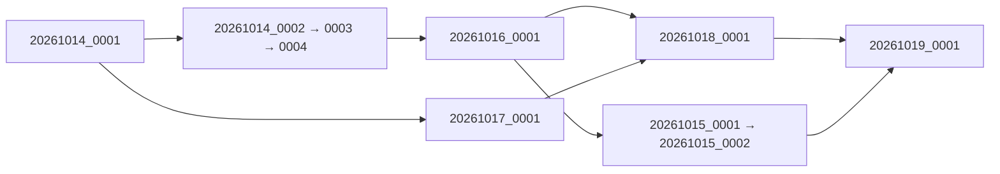

# Candidat final Pointeur / main fb4d9cd

Nouvelle branche `integration/pointeur-final-main-resync`, worktree isolé
`/private/tmp/atlas-pointeur-final-main-resync`, créée depuis
`42ca076a1a779aaaf38a9a14589c25e31e67a2e3`. Merge normal du main figé
`fb4d9cd175241a72773faf65eb046fe6c3ec96f6`. Aucun rebase, force push, modification
de main, autre worktree, Coolify ou production. Aucun push autorisé dans cette mission.

## Compatibilité et conflit

Un conflit : `package.json`, commande `test`. Résolution par union ordonnée des fichiers
des deux références : 98 fichiers, incluant le test des imports contrats DRH. Les autres
scripts et dépendances sont conservés. Aucun conflit métier ou données.

Les composants biométriques, scripts de sauvegarde/restauration, configuration et dépendances
authentification sont identiques au candidat42ca076a. Les imports de contrats DRH,
le push des offres et le mobile sont identiques au mainfb4d9cd. Les merges automatiques
conservent les routes contrats, Studio Badges, IRON Emploi et les protections Pointeur.

## Alembic

74 révisions et tête unique `20261019_0001`. Main possède71 révisions avec tête
`20261015_0002` ; aucune migration ajoutée depuis2e3369eb. Les74 migrations du candidat
et les71 de main sont conservées byte pour byte ; aucune jonction nouvelle nécessaire.

Le test PostgreSQL ajouté conserve les empreintes de toutes les lignes du main migré,
y compris contrat fictif, rapport d’import contractualisation, badges et Emploi, pendant
la montée15_0002→19 et son rejeu. Les tests existants couvrent schémas incomplets,
contraintes, autorisations peuplées, concurrence, migrations depuis les deux branches
et refus du downgrade destructif. Baseline main exportée du SHAfb4d9cd, pas d’accès production.

## Démarrage / sauvegarde / retour arrière

Le vrai `start.sh` et Gunicorn démarrent sur PostgreSQL jetable après migration19 ;
150tables, gabarit chiffré fictif lisible. Le codefb4d9cd seul échoue sur révision19inconnue ;
le même code avec graphe complet de migrations conservé démarre. Les empreintes de toutes
les données et les autorisations faciales restent identiques. Une sauvegarde GPG et sa
restauration complète du schéma150tables réussissent, marqueur19 conservé.

Ce rollback valide uniquement des données fictives, biométrie réelle désactivée et une clé
fictive active. Pour un retour opérationnel avec facial actif, conserver aussi le verrou
indépendant et les protections/chiffrement nécessaires dans un artefact testé. Aucune
ancienne image brute après migration, aucun stamp, suppression d’autorisation ou downgrade
facial peuplé. Le futur artefact Docker reste à construire et valider.

Python3.13 utilisé, helpers sauvegarde Python>=3.11. PostgreSQL local16.13 ; PostgreSQL
production17 : validation spécifique sur17encore nécessaire avant déploiement. Chrome
utilise serveurs/moteurs/caméras simulés ; aucun nouvel appareil activé.

## Résultats

La première exécution backend
est invalidée : un test ciblé lancé en parallèle a nettoyé la fixture SQLite partagée.
La suite est relancée seule, incluant le nouveau test. La première exécution frontend a
1096 réussites et1échec de lancement Chrome faute de permission ; suite relancée avec
l’autorisation nécessaire. Aucune de ces tentatives n’est comptée comme validation verte.

Les résultats historiques ne sont pas présentés comme nouvellement exécutés.

## Limites et prochaine étape

Pas de GO déploiement. Auto-deploy Coolify, matrice de permissions, verrou runtime,
état physique de TABLETTTE HAMOUL001, nouvelle sauvegarde de production restaurée et
images immuables restent les prérequis du plan pré-déploiement, à autoriser séparément.
Le défaut du verrou d’enrôlement restefalse : prévoir explicitement
`BIOMETRIC_ENROLLMENT_LOCKED=true` lors de la future opération autorisée.

**Reconnaissance faciale réelle : NO-GO pour toute nouvelle activation.**

## Validation finale nouvellement exécutée

|Contrôle|Résultat|
|---|---|
|Backend complet, avec PostgreSQL migrations/concurrence/sauvegardes|2556 réussis,19 ignorés,1 échec attendu ;355,79s|
|Frontend complet, assistant contrats Chrome inclus|1097 réussis,0échec/ignoré ;12prétests réussis|
|DRH-next / Core-v3|115 /45 réussis|
|Chrome Pointeur / DRH / Recrutement ciblé|42 réussis,0échec/ignoré|
|Mobile IRON Emploi|36 réussis ;typecheck et lint réussis|
|Préservation contrats/imports/Badges/Emploi PostgreSQL|Nouveau test réussi seul puis inclus dans backend complet|
|Démarrage candidat / rollback applicatif avec migrations|Réussis,150tables,révision19,empreintes inchangées|
|Sauvegarde GPG/restauration schéma joint|Réussies,150tables,révision19|

Journaux locaux : `/private/tmp/atlas-final-resync-validation/`.
Les19tests ignorés et le contrôle figé de permissions en échec attendu restent des limites,
non des réussites. La validation des appareils/moteurs faciaux réels n’est pas revendiquée.

**GO pour revue de la nouvelle branche locale. Aucun push, merge main ou déploiement.**
