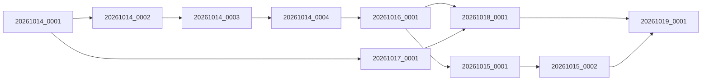

# Candidat Pointeur / IRON Emploi / Studio Badges

Extension autorisée de la revue de `integration/pointeur-main-resync`, après que main a avancé
à `2e3369eb` (Studio Badges). Merge normal dans le même worktree ; aucune modification de main,
rebase ou force push. Les branches historiques et les commits Candidatures DRH restent intacts.

## Résolutions

Quatre conflits techniques : versions de cache de `index.html` et du registre des modules,
liste des tests npm et tête attendue dans le test des vacations. Version commune :
`20261014-pointeur-badges-resync-v1`. Les 97 fichiers de tests frontend constituent l'union
des listes ; aucune suite Pointeur, IRON Emploi ou Badges n'est supprimée.

Le merge automatique d'`app/main.py` conserve `_GuardedUploads` et ajoute les routes Badges de
main. Le catalogue de permissions ajoute « drh / badges ». Les règles RBAC Pointeur, DRH/OPS,
le verrou d'enrôlement, le chiffrement biométrique et les scripts de stabilisation sont inchangés.

## Alembic

74 révisions, tête unique `20261019_0001`, parents `20261018_0001` et `20261015_0002`.
La nouvelle jonction ne fait aucune opération SQL. Aucun identifiant, parent ni contenu d'une
migration existante n'est modifié. Les exports Git `8197c333` et `2e3369eb` servent de baselines
PostgreSQL indépendantes ; toutes les lignes existantes sont comparées par empreinte.
Les cas d'une branche manquante et de deux branches déjà appliquées sont couverts.

## Retour arrière

Le `start.sh` de main `2e3369eb` ne connaît pas `20261019_0001`. Il ne faut pas redéployer
simplement cette ancienne image sur le schéma migré.

Le scénario non destructif retient le **code applicatif de main `2e3369eb` et tout le graphe de
migrations du candidat** dans un artefact de rollback dédié. Aucun downgrade, suppression
d'autorisation, restauration d'une ancienne base ou `stamp` forcé. Répéter le démarrage,
les lectures métier et le contrôle des données de cet artefact avant toute utilisation réelle.

Prérequis distincts : l'ancien code ne gère pas la lecture avec deux clés ni le verrou
indépendant d'enrôlement pendant un pointage facial actif. Si ces mécanismes sont nécessaires,
préparer un revert sélectif conservant ces composants de sécurité ; ne pas substituer une
ancienne clé ni désactiver silencieusement le verrou. Le scénario testé ne revendique pas
une validation de rotation sur des données réelles ni une activation faciale réelle.

Le rollback de schéma qualifié `20261017_0001@20261014_0001` ne retire que la branche faciale.
Il est testé avec table vide en conservant tous les badges et les données IRON Emploi ; s'il
existe des autorisations faciales, il refuse et la transaction préserve données et marqueur.
Les tables Badges peuplées ne sont pas supprimées.

## Runtime et périmètre

Python ≥ 3.11 pour les helpers de sauvegarde/restauration ; runtime de validation 3.13.
Aucune configuration ou donnée de production touchée. L'automatisation des sauvegardes reste
reportée au futur serveur physique. Le push ne sera fait qu'après validation, uniquement sur
`integration/pointeur-main-resync`. Aucun merge dans main ni déploiement.

**Reconnaissance faciale réelle : NO-GO pour toute nouvelle activation.**

## Résultats nouvellement exécutés

| Contrôle | Résultat |
|---|---|
| Jonctions Alembic, schémas peuplés, contraintes | 48 réussis |
| Backend complet (RBAC, verrou d'enrôlement, sauvegardes, concurrence, Badges, IRON Emploi) | 2529 réussis, 19 ignorés, 1 échec attendu |
| Frontend complet | 1093 réussis + 12 prétests |
| DRH-next / Core-v3 | 115 / 45 réussis |
| Chrome Pointeur / DRH / Recrutement | 42 réussis, 0 ignoré |
| Démarrage `start.sh` + Gunicorn après migration | Réussi, révision 20261019_0001, 150 tables |
| Main historique 2e3369eb seul sur le nouveau marqueur | Échec attendu : révision inconnue |
| Artefact main 2e3369eb + migrations du candidat | Démarrage et lecture du gabarit chiffré fictif réussis |
| Sauvegarde GPG et restauration du schéma joint | Réussies, 150 tables, révision 20261019_0001 |

Les empreintes de toutes les données existantes sont identiques après les démarrages et le
rollback applicatif, y compris badges, permissions et autorisations faciales. Le test conserve
une seule clé biométrique fictive active, la biométrie réelle désactivée et les tâches périodiques
isolées par leurs verrous dans la base jetable. Il ne valide ni les données ni la configuration
réelles de production.

Les tests backend ignorés sont 18 tests nécessitant OpenCV/modèles/portraits réels et un contrôle
PostgreSQL dans le contexte SQLite. L'échec attendu est le contrôle de la migration de permissions
figée ; le contrôle indépendant des contraintes passe. Le test de downgrade Badges a été rendu
explicite sur sa révision 20261015_0002 : il ne confond plus la branche Badges et la tête commune.

**GO pour revue et push de cette branche uniquement.** Aucun GO de déploiement ; les conditions
opérationnelles de rollback ci-dessus doivent être respectées. Reconnaissance faciale réelle :
**NO-GO pour toute nouvelle activation.**
